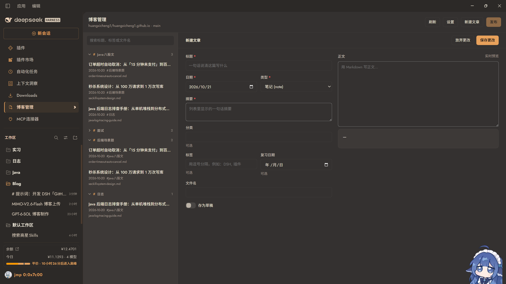

# DSH · GitHub Pages 博客管理插件

[](https://github.com/huangxicheng1/blog-manage/actions/workflows/tests.yml)

> 仓库：[`huangxicheng1/blog-manage`](https://github.com/huangxicheng1/blog-manage)
> · 包名：`dsh-hxc-blog` · 许可证：MIT

把 `huangxicheng1/huangxicheng1.github.io` 的内容管理搬进 DeepSeek Harness：
在左侧边栏打开一个**博客管理**面板，浏览、撰写、编辑、删除 `content/**/*.md`，
把变更作为一次明确的 commit 推回 `main`，然后盯着 GitHub Actions 把站点构建出来。

整个插件**不需要本地 git**，也**永远不会写 `entries.js`** —— 那个文件由 `build.py`
在 Actions 里生成，插件只负责 `content/` 下的 Markdown。

> **前提**：站点的 Pages 源必须设成 **GitHub Actions**（Settings → Pages → Source）。
> 如果还停在「Deploy from a branch」，GitHub 会自己把分支内容原样发布一遍，覆盖掉
> Actions 的产物，于是构建明明成功、线上却没有新文章。详见第 10 节。



---

## 1. 功能需求

### 1.1 它做了什么

| 能力 | 说明 |
| --- | --- |
| 侧边栏入口 | 在「Downloads」之后新增一行「博客管理」，点击打开主区域面板 |
| 双栏浏览 | 左栏**按 tag 分组**（可折叠、多 tag 重复出现、无标签单独成组），支持搜索、草稿标记、格式错误标记；右栏渲染预览，可切到源码 |
| 可视化编辑 | front matter 用表单填写（不手写 YAML），正文 Markdown 编辑 + 实时预览 |
| 发布前校验 | 按 `build.py` 规则校验，不通过就**拦住发布并高亮出错字段** |
| 一次 commit | 所有待发布变更合并成一次 commit（blob → tree → commit → ref），冲突时拒绝覆盖 |
| 构建反馈 | 推送后轮询 Actions 最新 run，显示「构建中 / 成功 / 失败」，成功给出站点链接 |
| 自动化接口 | HTTP 路由 + Host 服务 + 浏览器事件三种钩子，见第 7 节 |

### 1.2 连接与浏览

设置面板配置 GitHub fine-grained PAT（加密存储）、仓库、分支、内容目录、站点地址。
点击侧边栏按钮后，主区域打开双栏界面。

**左栏：按 tag 分组**（详见第 2 节）

- 从每篇文章 front matter 的 `tags` 提取标签，**一个标签一个分组**，分组标题显示「标签名 + 文章数量」。
- **可折叠 / 展开**：点击分组标题收起或展开，折叠状态**会记忆**（重开 DSH 仍然保留）。
- 一篇文章有**多个 tag 时，同时出现在多个分组下**；没有 tag 的归入「无标签」分组，永远排在最后。
- 分组内每篇文章显示**标题、日期、其余标签（灰色小字）、文件名**；草稿与格式错误各有徽标，有未发布更改时标题右侧有小圆点。
- **搜索**支持标题、标签、文件名（另外也匹配摘要、分类与路径）。

**右栏**：选中文章的 Markdown 渲染预览，可切换源码模式；顶部显示 front matter 元信息
（类型、分类、标签、复习日期、日期），并显示文章 id。

### 1.3 可视化编辑与发布

- 「编辑 + 实时预览」分屏编辑器，正文左侧编辑、右侧即时渲染。
- 新建文章时 front matter 用**表单**填写：标题、日期（默认今天）、类型（diary / note 下拉，
  决定写入 `content/diary/` 还是 `content/notes/`）、摘要、分类（仅 note 显示）、标签、
  复习日期、草稿开关、文件名。
- 保存前在本地按 `build.py` 的规则校验，不通过则阻止发布并高亮错误字段。
- 编辑后显示「未发布更改」标记；发布时弹出确认框，显示变更文件列表
  （`M` 修改 / `D` 删除）和 commit message 输入框，确认后通过 GitHub API 创建单个 commit 并推进分支。

### 1.4 发布状态反馈

推送成功后查询该仓库最新 Actions workflow run，显示「构建中 / 成功 / 失败」，
成功后给出 `https://huangxicheng1.github.io/` 链接，失败时给出构建日志链接。

### 1.5 自动化扩展

HTTP 路由、Host 服务、浏览器事件三个入口，见第 7 节。

---

## 2. 内容浏览视图：按标签分组

左栏的组织原则是 **tag**，不是目录。规则全部落在 `client.js` 的
`groupArticlesByTag()` 与 `articleMatchesQuery()` 两个纯函数里，
由 `test/tag-groups.mjs` 直接验证：

| 行为 | 规则 |
| --- | --- |
| 分组键 | front matter 的 `tags`（逗号分隔，中英文逗号都接受） |
| 分组标题 | `#` + 标签名 + 文章数量 |
| 折叠 | 点击分组标题，箭头旋转；`aria-expanded` 随状态变化 |
| 折叠记忆 | 存 `localStorage` 的 `dsh-gh-blog:collapsed-tag-groups`；读取失败或值损坏时退化为「全部展开」，不会抛错 |
| 搜索时 | 自动全部展开（搜索是明确的「我要看结果」），清空搜索后恢复折叠记忆 |
| 多 tag | 一篇文章出现在它每个 tag 的分组下，重复出现是预期行为 |
| 无 tag | 归入「无标签」分组，**永远排在最后** |
| 分组顺序 | 文章数多的在前；数量相同按首次出现顺序（文章列表本身按日期倒序，所以是最新文章所属的标签先出现）。刻意不用 `localeCompare`，避免排序依赖运行时的 ICU 数据 |
| 卡片 | 标题 / 日期 / **其余标签**（灰色小字 `#a #b`，即全部标签减去当前分组的那个）/ 文件名（等宽小字） |
| 搜索字段 | 标题、标签、文件名；另外也匹配摘要、分类、路径 |

「其余标签」是卡片的关键细节：分组标题已经说明了当前标签，卡片再重复一遍就是噪音，
所以卡片只显示**剩下的**标签 —— 这也回答了「这篇文章为什么会出现在这里」之外的信息。

---

## 3. 安装

这是一个 DSH bundle 包，用 `plugin_manager` 的 `install_bundle` 安装。
**不要**在 profile 目录里手写 `package.json`，也不要在那里跑 pnpm —— `install_bundle` 会做完这些。

### 从 npm 安装（最省事）

```
plugin_manager  action: install_bundle  target: dsh-hxc-blog
```

包在 npm 官方源上：<https://www.npmjs.com/package/dsh-hxc-blog>。
当前版本 `0.1.1`，声明兼容 DSH `>=0.2.1-rc.2`。

### 从 GitHub 安装

```bash
git clone https://github.com/huangxicheng1/blog-manage.git
```

然后把 `install_bundle` 的 `target` 指向 clone 下来的目录绝对路径：

```
plugin_manager  action: install_bundle  target: <clone 目录的绝对路径>
```

`install_bundle` 的 `target` 要的是本机路径，所以先 clone 再指过去，不要直接填 URL。
如果你只是想让 DSH 去拉这个仓库，`dsh plugin add github:huangxicheng1/blog-manage` 也可以。

### 从本地工作目录安装

如果你就在改这份源码，直接把 `target` 指向工作目录。本地目录安装是**链接**方式，
改完 `client.js` 刷新页面即可生效，不必重装。

安装完成后刷新 Web GUI：

- 左侧边栏出现「博客管理」（位于「Downloads」下方）；
- 「插件」页里出现一行 `GitHub Pages Blog`，带本插件自己的图标。

若之后改动了 **Host 端**（`index.js` / `lib/*`），需要重启 Harness 让新的 JavaScript
模块代次生效（Node 会缓存已导入的模块，重装不会绕过它）。

### 可选：用配置固定默认值

`cordis.patch.yml` 里的 `config` 全部可选，用于给某台机器钉住默认仓库/分支：

```yaml
- insert:
    - id: gh-blog
      name: dsh-hxc-blog
      config:
        repository: huangxicheng1/huangxicheng1.github.io
        branch: main
        contentRoot: content
        siteUrl: https://huangxicheng1.github.io/
```

优先级：内置默认值 < `cordis.patch.yml` 的 `config` < 设置面板里保存的值。

---

## 4. 配置 Token

1. 打开 <https://github.com/settings/tokens?type=beta> 创建一个 **fine-grained** PAT。
2. **Repository access**：只勾选 `huangxicheng1.github.io` 这一个仓库。
3. **Permissions**：
   - `Contents`: **Read and write** —— 读写文章；
   - `Actions`: **Read** —— 读取构建状态（可选；没有它只是看不到构建结果，推送仍然可用）。
4. 回到 DSH，侧边栏「博客管理」→ 右上角「设置」→ 粘贴 Token → 「保存设置」→「测试连接」。

Token 存在哪里：

- 它走 DSH 的 **凭据服务**（`credentials`），键名 `GH_BLOG_GITHUB_TOKEN`，属于
  provider 管理的可写存储，**不会**写进本插件的设置文件，也不会出现在页面 JavaScript 里
  —— 浏览器端只和 DSH Host 的 `/api/gh-blog/*` 通信，从不直连 `api.github.com`。
- 也可以不填面板，改用同名环境变量 `GH_BLOG_GITHUB_TOKEN` 提供（凭据服务会回落到环境）。
- 面板里留空保存 = 保持现有 Token 不变；打开「清除已保存的 Token」再保存 = 删除。

非敏感设置（仓库、分支、内容目录、站点地址）存在：

```
$DSH_HOME/gh-blog/settings.json
```

写入是原子的（临时文件 + rename），权限 `0600`。

---

## 5. front matter 规范（与 `build.py` 一致）

文档必须以 `---` 开头、以 `---` 结束，中间**只允许简单 `key: value` 行**
（不支持嵌套、列表、多行标量）。

### 必填

| 字段 | 规则 |
| --- | --- |
| `title` | 非空，单行，≤ 200 字符 |
| `date` | `YYYY-MM-DD`，且必须是真实存在的日历日（`2026-02-30` 会被拒绝） |
| `type` | 只能是 `diary` 或 `note` |
| `summary` | 非空，单行 |

### 可选

| 字段 | 规则 |
| --- | --- |
| `category` | 只对 `note` 有意义；不填视为「未分类」；写在 `diary` 上只做提醒，不会阻止发布 |
| `tags` | 逗号分隔**字符串**（保存时会统一成 `半角逗号 + 空格`；中文逗号也接受）。左栏就是按它分组的 |
| `review` | `YYYY-MM-DD`，复习日期 |
| `draft` | `true` 时不发布；只接受 `true` / `false` |

### 文件名与 id

- 文章 id = 文件相对 `content/` 的路径（去掉扩展名），例如 `notes/2026-10-21-my-note`。
- 新建时插件按 `type` 决定目录，按 `date` + 文件名生成路径：

  ```
  content/diary/<date>-<slug>.md
  content/notes/<date>-<slug>.md
  ```

- 文件名只允许字母、数字、中文、`.`、`_`、`-`，且不能以符号开头。
- 文件名日期与 `date` 不一致只是**警告**（文章 id 会与日期不一致，但不影响构建）。

### 校验分两级

- **error**：会阻止发布（缺必填字段、日期非法、`type` 非法、正文为空、目录与类型不匹配等）。
- **warning**：只提示（未知字段、diary 上的 category、文件名日期不一致、摘要偏长）。

规则实现在 `lib/content-store.js`，`validateDraft` / `publish` 共用同一份实现，
所以「编辑器认为可以发布」和「推送前实际校验」不会出现分歧。

---

## 6. 日常使用

1. **写一篇**：右上角「新建文章」→ 填标题/日期/类型/摘要（note 才有分类）→ 写正文 →
   「保存更改」。这一步只在本地待发布区暂存，**不会**动 GitHub。
2. **改一篇**：左栏选中 → 「编辑」→ 改完「保存更改」。
3. **删一篇**：右栏「删除」→ 确认，同样只进待发布区（从未发布过的文章删除时只从待发布区移除，
   不会产生空 commit）。
4. **发布**：顶栏「发布（N）」→ 确认框里能看到**变更文件列表**和 commit message 输入框 →
   「推送到 GitHub」。
5. **看构建**：推送成功后顶部出现状态条，轮询 Actions，成功后给「打开站点」。

### 冲突处理

推送前会按本地记录的 blob sha 逐个比对远端：

- 远端 sha 变了 → 拒绝覆盖，提示是哪一篇冲突，**你的修改仍留在编辑器里**；
- 新建文件时若远端已存在同名文件 → 同样拒绝；
- 最后一步 `ref` 更新用 `force: false`，即使比对之后远端又变了，GitHub 也会拒绝这次推进。

任何一步失败都不会产生半个 commit：变更通过 Git Trees API 一次性组装。

---

## 7. 自动化钩子

三个入口，全部复用同一份 `publish` / `validateDraft` 实现，不存在“UI 一套、自动化一套”。

### 7.1 HTTP 路由 —— 给「自动化任务」/ 脚本用

```
POST /api/gh-blog/automation/create
```

```jsonc
{
  "title": "今天的复盘",
  "date": "2026-10-21",          // 省略则用今天
  "type": "note",                // diary | note，默认 note
  "summary": "一句话摘要",         // 省略则取正文首段
  "category": "工程",             // 仅 note
  "tags": ["复盘", "DSH"],
  "review": "2026-11-01",        // 可选
  "draft": false,
  "body": "## 今天做了什么\n\n- 写了插件\n",
  "slug": "daily-review",        // 可选，省略则由标题推导
  "publish": true,               // false 则只返回序列化结果，不写仓库
  "confirm": true,               // publish: true 时必填，避免脚本误发布
  "commitMessage": "blog: 自动写入今日复盘"
}
```

返回：

```jsonc
{ "ok": true, "value": { "commit": { "sha": "…", "url": "…" }, "path": "content/notes/2026-10-21-daily-review.md", "published": true } }
```

`publish: false` 时返回 `{ path, text, published: false }`，让你自己决定后续。

失败统一是：

```jsonc
{ "ok": false, "error": { "code": "invalid-front-matter", "message": "…", "details": { "errorsByPath": { "content/notes/x.md": [{ "field": "date", "message": "…" }] } } } }
```

同样存在 `POST /api/gh-blog/automation/contract`，返回机器可读的契约描述。

### 7.2 Host 服务 `ghBlog` —— 给同进程的其他插件 / 未来的 Agent 工具

```js
const blog = ctx.get('ghBlog')
await blog.validateDraft({ form, slug })     // 只校验，不联网
await blog.publish({ changes, message })     // 一次 commit
await blog.listArticles({ refresh: true })
await blog.readArticle({ path })
await blog.latestRun()
```

`changes` 的每一项形如 `{ path?, form, slug?, expectedSha }`（新建时 `expectedSha: null`
表示「必须不存在」），删除用 `{ path, delete: true, expectedSha }`。

### 7.3 浏览器事件 `dsh-gh-blog:draft` —— 把 AI 产出的草稿直接送进编辑器

```js
window.dispatchEvent(
  new CustomEvent('dsh-gh-blog:draft', {
    detail: { title: '草稿', type: 'note', summary: '…', body: '## 内容', tags: ['AI'] },
  }),
)
```

面板会切到编辑分屏并把内容填进表单。**它只暂存，不发布** —— commit 仍然需要人看着
变更列表点一次确认，这是有意为之。

---

## 8. 验收标准

1. **侧边栏入口**：左侧边栏出现「博客管理」，点击可打开插件界面。
2. **内容浏览视图**：左栏按 tag 分组，且
   - 每个标签一个分组，标题显示「标签名 + 文章数量」；
   - 点击分组标题可折叠 / 展开，且**折叠状态在重开 DSH 后仍然保留**；
   - 一篇文章有多个 tag 时**同时出现在多个分组下**；
   - 没有 tag 的文章归入「无标签」分组，并且该组**排在最后**；
   - 分组内每篇显示标题、日期、其余标签（灰色小字）、文件名，草稿有标记；
   - 搜索支持按标题、标签、文件名。
3. **连接与预览**：配置 Token 后能列出 `content/diary/` 与 `content/notes/` 下所有文章并渲染预览，草稿有标记。
4. **新建并发布**：能通过表单新建一篇 note，保存到 `content/notes/`，推送后 GitHub Actions 自动构建，
   数分钟后文章出现在 <https://huangxicheng1.github.io/> 上。
5. **校验一致**：front matter 校验与 `build.py` 行为一致 —— 缺必填字段、日期格式错误、type 非法
   都会在发布前被拦截。
6. **可修改**：能编辑、删除已有文章，所有变更走明确的 commit，GitHub 上可查历史。
7. **自动化钩子**：接口有文档说明和最小调用示例。

### 本仓库的验证方式

```bash
node test/tag-groups.mjs    # 17 项：tag 分组、多 tag 归属、无标签组、顺序、搜索字段、折叠记忆读取
node test/run.mjs           # 49 项：front matter 一致性、GitHub 客户端（重试/超时/冲突/权限错误映射）、发布守卫
node test/host-routes.mjs   # 14 项：10 条路由注册、设置持久化、自动化契约、端到端发布
```

对应关系：验收 2 由 `tag-groups` 覆盖；验收 5 由 `run.mjs` 覆盖；验收 4、6、7 由 `host-routes.mjs`
的端到端用例覆盖（route → service → github-client → 桩 API）。验收 1 与 3 的**渲染视觉**部分
依赖真实浏览器，见第 10 节。

---

## 9. 代码结构

```
blog-manage/
├── index.js               Host 半：注册 /api/gh-blog/* 路由、提供 ghBlog 服务
├── client.js              浏览器半：侧边栏入口 + 主区域面板（内部按模块分段）
├── lib/
│   ├── content-store.js   front matter 解析 / 序列化 / 校验（与 build.py 对齐）
│   ├── github-client.js   GitHub REST 封装：超时、重试、原子 commit
│   ├── blog-service.js    业务编排：设置 + 凭据 + 上述两者
│   ├── settings-store.js  非敏感设置持久化（原子写）
│   └── automation.js      阶段 3 契约 + 请求归一化
├── locale/{zh,en}.json    插件在「插件」页的标题与描述
├── icon.svg               插件图标
├── cordis.patch.yml       bundle patch
├── .github/workflows/     CI：语法检查 + 三个测试套件
├── screenshots.json       市场详情页的截图清单（相对路径，1-8 张）
├── docs/                  README 与市场共用的截图
├── LICENSE                MIT
└── test/                  无依赖验证脚本（见第 8 节）
```

包名 `dsh-hxc-blog` 与仓库名 `blog-manage` 不同是有意的：仓库名描述用途，
包名是装进 profile 里的标识。内部**功能 id 仍叫 `gh-blog`**，所以你会看到：

- bundle 入口 id `gh-blog`（既是边栏按钮的 id，也是主区域面板的 key）；
- Host 路由前缀 `/api/gh-blog/*`；
- 浏览器事件 `dsh-gh-blog:draft`。

这三处是接线名，不是包名，重命名它们只会让已写好的自动化脚本失效。

`client.js` 是一个文件，因为 Client loader 每个插件只加载一个产物；文件内按
`--- module: api / i18n / markdown / ui / editor / settings / panel` 分段，
与 Host 端的模块边界一一对应。左栏的分组与搜索是两个**纯函数**
（`groupArticlesByTag` / `articleMatchesQuery`），从组件里独立出来，
因此可以脱离 DOM 直接断言。

---

## 10. 已知边界

- **只看不写 `entries.js`**：符合约定，构建交给 Actions。
- **站点必须是「Pages 源 = GitHub Actions」**。若仓库仍是从分支部署（`build_type: legacy`），
  GitHub 会把分支内容原样发布一遍、覆盖 Actions 产物，`entries.js` 必须由工作流提交回仓库
  才生效——那一来「插件不写 `entries.js`」的前提就不成立了。排查方法是看线上
  `entries.js` 的字节数是否等于仓库里被提交的那一份：相等就说明它在用旧文件。
- **一篇文章在左栏出现多次**是 tag 视图的预期结果，不是重复 bug。
- **不支持改名**：改文章路径 = 删除 + 新建，这样 Git 历史里是一次明确的删与建。
- **Actions 状态是轮询**（6 秒首查，之后 15 秒一次，最多约 10 分钟），不是 webhook。
- **构建状态需要 `Actions: Read`**；没有该权限时推送照常成功，状态条显示「未知」。
- **草稿不发布**：`draft: true` 的文章照常提交，由 `build.py` 决定不收录 —— 插件不改这个语义。
- **折叠状态存在浏览器本地**（`localStorage`），换浏览器或清缓存会回到「全部展开」。

---

## 11. 许可证

[MIT](LICENSE) © 2026 huangxicheng1
